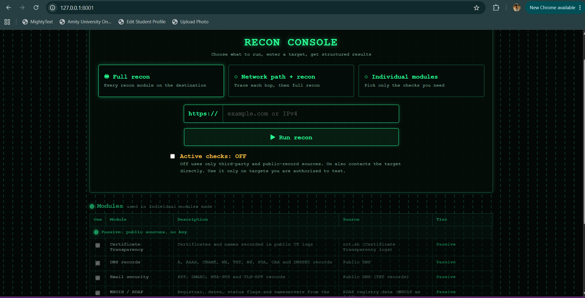
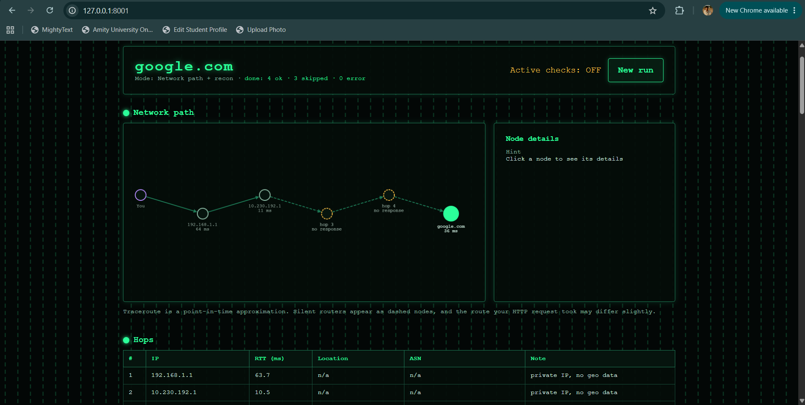
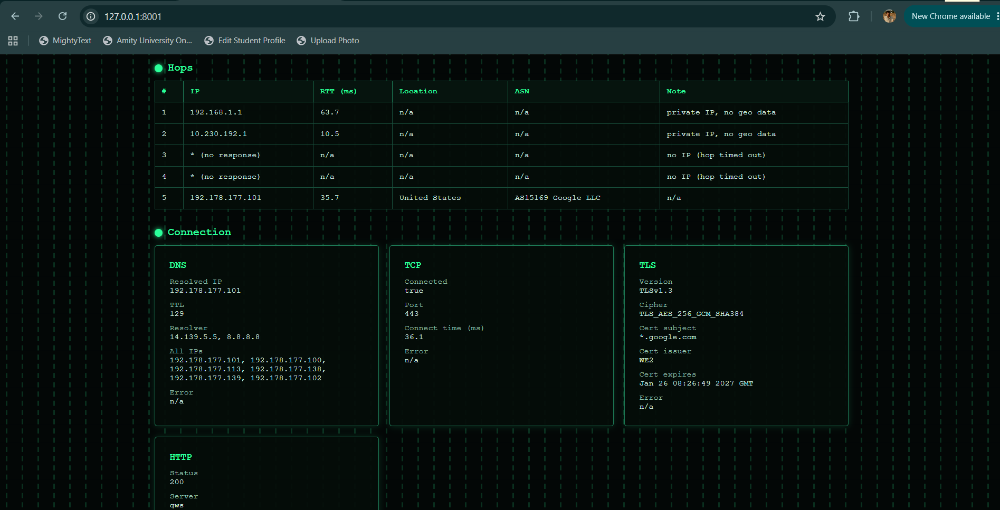
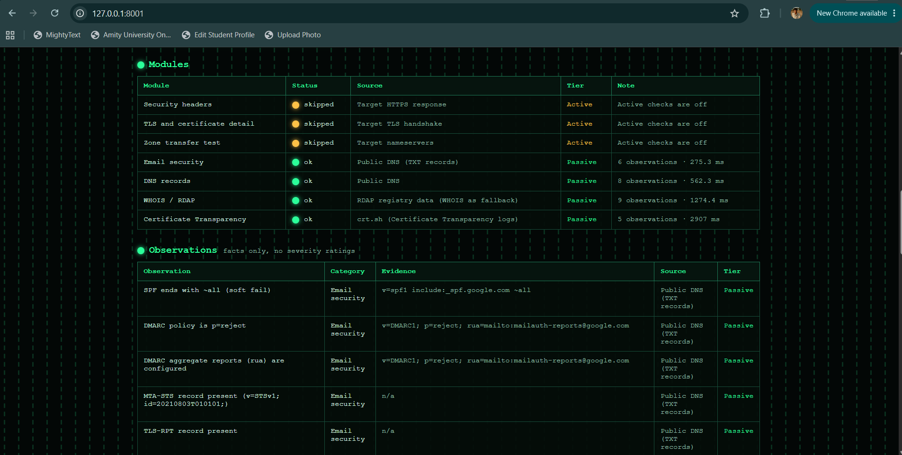
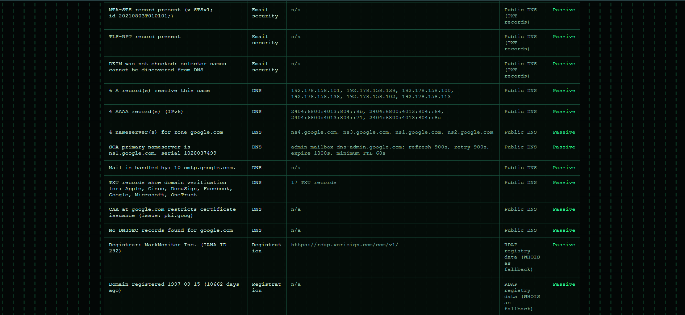
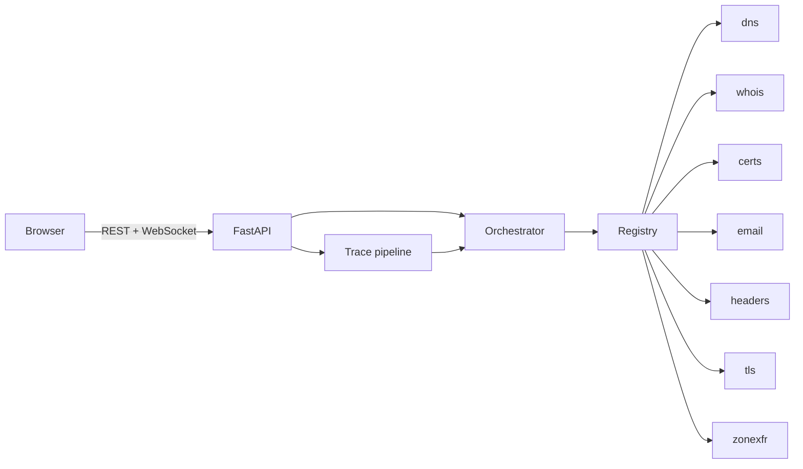

# Recon Console


A local web console that traces the network path to a target and collects structured, source-labelled reconnaissance about it. It is **passive by default**, and every check that contacts the target directly is opt-in and clearly labelled.

Results are plain observations with a source, a tier and a timestamp. The tool does not rate findings or compute risk scores.

## Contents

- [Screenshots](#screenshots)
- [Features](#features)
- [Responsible use](#responsible-use)
- [How it works](#how-it-works)
- [Modules in detail](#modules-in-detail)
- [Security design](#security-design)
- [Requirements](#requirements)
- [Setup](#setup)
- [Run](#run)
- [Using the console](#using-the-console)
- [Configuration](#configuration)
- [API reference](#api-reference)
- [Project structure](#project-structure)
- [Adding a module](#adding-a-module)
- [Tests](#tests)
- [Troubleshooting](#troubleshooting)
- [Known limitations](#known-limitations)
- [Roadmap](#roadmap)
- [FAQ](#faq)
- [Contributing](#contributing)
- [Acknowledgements](#acknowledgements)
- [License](#license)

## Screenshots






-->

## Features

- **Three run modes:** Full recon, Network path + recon, and Individual modules.
- **Live network path:** a traceroute graph that grows hop by hop, with each hop's location and ASN from GeoLite2, plus DNS, TCP, TLS and HTTP connection details.
- **Modular recon:** seven modules today, each independent and swappable. New modules appear in the page automatically.
- **Tiered by design:** every module is tagged `passive` (public data sources) or `active` (contacts the target). Active modules run only when you switch Active checks on.
- **Structured results:** one standard result envelope per module, so the page can render any module the same way, including raw data for inspection.
- **Failure isolation:** a module that errors or times out becomes a labelled result. It never stops the others.
- **Streaming:** results arrive over WebSockets as each module finishes, so slow sources do not hold up fast ones.
- **Terminal-style interface** with a static code-rain backdrop (no animation).

## Responsible use

Passive modules read public data sources. **The network path and every active module contact the target directly.** Use them only on systems you own or are authorized to test.

This tool has no authentication and no rate limiting. Run it on your own machine and do not expose it to the internet.

## How it works



### Run modes

| Mode | What runs | Endpoint used by the page |
|---|---|---|
| Full recon | Every recon module that applies to the target | `WS /ws/recon` |
| Network path + recon | DNS resolution, traceroute with enrichment, TCP, TLS, HTTP, then every recon module | `WS /ws/trace` |
| Individual modules | Only the modules you tick | `WS /ws/recon` with a module list |

### The module contract

Every recon module is a small class. It declares who it is and implements one method, `collect()`, which gathers data and returns `(data, observations)`. It may simply raise on failure.

A shared `run()` method wraps `collect()` and returns a standard `ModuleResult`. This is what makes the system loosely coupled: a module cannot forget the envelope, an exception cannot escape, and the page needs no per-module code.

```json
{
  "module": "dns",
  "name": "DNS records",
  "tier": "passive",
  "status": "ok",
  "source": "Public DNS",
  "collected_at": "2026-01-01T12:00:00+00:00",
  "duration_ms": 231.2,
  "data": { "zone": "example.com", "a": ["203.0.113.10"], "...": "..." },
  "observations": [
    {
      "text": "1 A record(s) resolve this name",
      "category": "DNS",
      "evidence": "203.0.113.10",
      "source": "Public DNS",
      "tier": "passive"
    }
  ],
  "error": null,
  "note": null
}
```

*(Abridged, with illustrative values.)* `status` is `ok`, `error` or `skipped`. A skipped module carries the reason in `note`.

### The orchestrator

Given a target, a module list and the active flag, the orchestrator:

1. Validates the target, resolves it, and refuses non-public addresses.
2. Decides, per module, whether to run or skip it. Skip reasons are: Active checks are off, no API key configured, or the module does not accept this kind of target (domain or IP).
3. Yields skipped results immediately, then runs the rest concurrently (up to 8 workers) and yields each result as it finishes.
4. Reports any module still running after 120 seconds as a timed-out error.

### The network path pipeline

1. Validate and resolve the target.
2. Run `tracert`, reading its output line by line so hops stream as they are discovered.
3. Enrich each hop with city, country and ASN from the local GeoLite2 databases. Private addresses are flagged as such.
4. Connect over TCP, then TLS, then make one HTTPS request (redirects checked, body not downloaded, `Set-Cookie` values never forwarded).
5. Run the recon modules through the orchestrator and stream each result.

Traceroute is a point-in-time approximation. Routers may stay silent (shown as dashed nodes), and the route your HTTP request took can differ slightly.

## Modules in detail

| Module | Id | Tier | Source |
|---|---|---|---|
| DNS records | `dns` | Passive | Public DNS |
| WHOIS / RDAP | `whois` | Passive | RDAP registry servers, WHOIS as fallback |
| Certificate Transparency | `certs` | Passive | crt.sh |
| Email security | `email` | Passive | Public DNS (TXT records) |
| Security headers | `headers` | Active | Target HTTPS response |
| TLS and certificate detail | `tls` | Active | Target TLS handshake |
| Zone transfer test | `zonexfr` | Active | Target nameservers |

All current modules accept domain names. IP address targets are supported by the path view and skip the domain-only modules with a clear note.

### DNS records (`dns`)
A, AAAA, CNAME, MX, TXT, NS, SOA and CAA records, plus whether DS and DNSKEY records exist (presence only, the DNSSEC chain is not validated). NS, SOA and DNSSEC are read for the zone the name belongs to, found automatically for subdomains. TXT records are scanned for domain-verification entries that reveal third-party services (Google, Microsoft, Apple, Facebook, DocuSign, and others). A missing CAA record is reported as a fact.

### WHOIS / RDAP (`whois`)
Finds the registry's RDAP server through IANA's public bootstrap list, then reports the registrar and IANA ID, registration, expiry and last-changed dates, status flags, registered nameservers, the registry's DNSSEC delegation flag, and whether a registrant contact is published. If no RDAP server exists for the TLD or the query fails, it falls back to a WHOIS lookup and says so.

### Certificate Transparency (`certs`)
Queries crt.sh for every logged certificate: the number of certificates, unique names (and wildcards), the issuing CA names with counts, and the date range. Entries that do not belong to the domain, such as crafted names that imitate it, are set aside and reported separately. crt.sh is slow at times, so the request retries and times out gracefully.

### Email security (`email`)
SPF (final mechanism and what it means, multiple-record errors, redirects), DMARC (policy, subdomain policy, report address, percentage), MTA-STS record presence, and TLS-RPT record presence. DKIM is not checked because selector names cannot be discovered from DNS, and the result says so.

### Security headers (`headers`, active)
One HTTPS request with redirects followed by hand, and one plain request to port 80. Reports HSTS (parsed), Content-Security-Policy (directive count, `unsafe-inline`, `unsafe-eval`, `frame-ancestors`), Report-Only policies, X-Content-Type-Options, X-Frame-Options, Referrer-Policy, the cross-origin policies, Permissions-Policy, CORS, version-disclosing headers, and each cookie's flags (Secure, HttpOnly, SameSite). **Cookie values are never stored.** Also reports whether port 80 redirects to HTTPS.

### TLS and certificate detail (`tls`, active)
Negotiated version and cipher, whether TLS 1.3 and 1.2 are accepted, whether the certificate validates against this machine's trust store (and why not, if it fails), expiry and issue dates, issuer, subject, covered names, public key type and size, signature hash, self-signed status, embedded Certificate Transparency timestamps, and the OCSP responder. The certificate is read even when validation fails, so broken certificates still get described. The connection goes to the exact IP address that was just checked. Requires the `cryptography` package.

### Zone transfer test (`zonexfr`, active)
Finds the zone a name belongs to, resolves its nameservers (up to six), and asks each for a full transfer (AXFR). Each answer is classified as refused, allowed, timed out, error, or skipped. If a transfer is allowed, the result records the record count and a sample of names, and stops reading at 5,000 records. Nameservers that resolve to non-public addresses are never contacted. For testing, `zonetransfer.me` is a practice domain published for this purpose.

## Security design

A tool that fetches whatever you type is a risk if it is careless, so the safeguards are part of the design.

| Risk | Safeguard |
|---|---|
| Option injection into `tracert` | Targets are normalized and matched against a strict hostname or IPv4 pattern. Flags, spaces, credentials, ports and shell characters are rejected. Subprocess calls pass arguments as a list, never through a shell. |
| Server-side request forgery (SSRF) | Every resolved address must be public. Loopback, private, link-local and carrier-grade NAT ranges are refused, and every address of a multi-record name is checked. |
| Redirect-based SSRF | Redirects are followed by hand, up to 5, and each hop is resolved and checked again. |
| Oversized or hostile responses | Bodies are not downloaded unless needed, and reads are capped. |
| Stored cross-site scripting | The page renders all remote data with `textContent`, never `innerHTML`. |
| Accidental active scanning | Active checks turn on only for a literal JSON `true`. A string such as `"yes"` does not enable them. |
| Leaking secrets | Cookie values and `Set-Cookie` headers are never stored or forwarded. |
| Cached DNS answers changing between check and use (DNS rebinding) | The TLS module connects to the validated IP address. Other requests resolve the hostname again, which is listed under known limitations. |

## Requirements

- Python 3.10 or newer (developed on 3.11)
- Windows for the network path view, which currently uses `tracert`. All other modes run on any operating system.
- The GeoLite2 City and ASN databases (free MaxMind account). The application will not start without them.
- Python packages from `requirements.txt` (FastAPI, Uvicorn, websockets, dnspython, requests, geoip2, cryptography, python-whois, pydantic)

## Setup

```powershell
git clone <your-repo-url>
cd <repo-folder>
python -m venv .venv
.venv\Scripts\Activate.ps1
pip install -r requirements.txt
```

### GeoLite2 databases

The databases are not in this repository because MaxMind's license does not allow redistributing them.

1. Create a free account at [maxmind.com](https://www.maxmind.com/en/geolite2/signup).
2. Download **GeoLite2 City** and **GeoLite2 ASN** in the `.mmdb` format (not CSV).
3. Extract them and copy `GeoLite2-City.mmdb` and `GeoLite2-ASN.mmdb` into `app/geoip/`.

## Run

```powershell
python -m uvicorn app.main:app --reload
```

Open http://127.0.0.1:8000

Run commands from the project root. Always use the `python -m uvicorn` form, because the `uvicorn` command is often not on the Windows PATH.

## Using the console

1. **Choose a mode.** Full recon, Network path + recon, or Individual modules.
2. **Enter a target:** a domain or an IPv4 address. A pasted URL is reduced to its hostname.
3. **Decide on Active checks.** They are off by default. Turn them on only for targets you are authorized to test.
4. **For Individual modules,** tick the modules you want in the table. Modules that need active checks or an API key are greyed out until they are available.
5. **Run.** Results stream in:
   - the path graph, hop table and connection cards (path mode)
   - a modules table showing ok, skipped or error for each module, with the reason when skipped
   - an observations table where every row shows its category, evidence, source and tier
   - a Raw data section with each module's full output
6. **New run** returns to the start page.

## Configuration

| Variable | Default | Purpose |
|---|---|---|
| `ALLOW_PRIVATE_TARGETS` | `false` | Set to `true` to allow private addresses, for example to test your own LAN |

```powershell
$env:ALLOW_PRIVATE_TARGETS = "true"
```

Modules that need an API key declare the environment variable they read, and are skipped with a clear note until it is set. No current module needs one.

## API reference

### REST

| Endpoint | Purpose |
|---|---|
| `GET /modules` | List modules with id, name, description, tier, source, whether a key is needed and configured, and accepted target kinds |
| `GET /recon?target=example.com&active=false&modules=dns,whois` | Run full recon, or the listed modules, and return every result |
| `GET /recon/{module}?target=example.com&active=false` | Run one module |
| `GET /trace?target=example.com&active=false` | Run the full trace and return everything at once |
| `GET /health` | Liveness check |

An invalid target returns `400`, and an unknown module returns `404`.

### WebSocket protocol

Connect to `/ws/recon` or `/ws/trace`, then send one JSON message:

```json
{ "target": "example.com", "modules": ["dns", "whois"], "active": false }
```

`modules` may be omitted or `null` to run everything. `active` turns on active checks only when it is exactly `true`.

**`/ws/recon` sends:**

| Event | Meaning |
|---|---|
| `{"stage": "module", "data": <ModuleResult>}` | One module finished, in completion order (skipped modules first) |
| `{"stage": "done", "data": {"count": 3}}` | All modules reported |
| `{"stage": "error", "data": {"message": "..."}}` | The request or target was rejected |

**`/ws/trace` sends,** in this order, each with `timestamp_utc` and `elapsed_ms`: `dns`, then one `hop` per router, then `tcp`, `tls` (only if the TCP connection succeeded), `http`, then one `module` per recon module, and finally `done`. A failed validation or DNS lookup ends the stream with an `error` event.

The server closes the socket after `done` or `error`.

## Project structure

```
.
├── app/
│   ├── main.py                  FastAPI app, static files, routers
│   ├── pipeline.py              Trace pipeline (streams events)
│   ├── core/
│   │   ├── models.py            ModuleResult and Observation
│   │   ├── base.py              ReconModule contract
│   │   ├── registry.py          Module registry
│   │   ├── orchestrator.py      Runs modules concurrently, applies the rules
│   │   ├── validation.py        Target validation and public-address guard
│   │   ├── http_fetch.py        Redirect-safe, size-capped HTTP
│   │   ├── dns_resolver.py      Resolution for the trace
│   │   ├── hop_tracer.py        Streaming traceroute
│   │   ├── ip_enrichment.py     GeoLite2 city and ASN lookups
│   │   └── connection.py        TCP, TLS and HTTP stages of the trace
│   ├── modules/                 One file per recon module
│   ├── routers/                 recon.py and trace.py endpoints
│   ├── geoip/                   Put the GeoLite2 .mmdb files here (not committed)
│   └── static/                  index.html, style.css, app.js, path.js
├── tests/
├── requirements.txt
├── requirements-dev.txt
├── LICENSE
└── README.md
```

## Adding a module

1. Create a file in `app/modules/`.
2. Subclass `ReconModule`, fill in the metadata, implement `collect()`, and decorate the class with `@register`.
3. Add the import to `app/modules/__init__.py`.

The API and the page pick it up automatically. No frontend change is needed.

```python
from app.core.base import ReconModule
from app.core.registry import register


@register
class ExampleModule(ReconModule):
    id = "example"                   # short, stable, used in URLs
    name = "Example"
    description = "What it checks"
    tier = "passive"                 # "active" if it contacts the target
    source = "Where the data comes from"
    accepts = ("domain",)            # and/or "ip"
    # api_key_env = "EXAMPLE_API_KEY"   # set this if the source needs a key

    def collect(self, target):
        data = {"target": target}
        observations = [self.observe("A plain-language fact", "Category")]
        return data, observations
```

Guidelines for modules:

- **Report facts, not verdicts.** Observations describe what was seen. They do not rate it.
- **Be honest about the tier.** If it sends anything to the target, it is `active`.
- **Raise on failure.** `run()` turns it into a labelled error result.
- **Never store secrets.** No cookie values, tokens or credentials in results.
- **Use the shared guards.** Use `safe_get` for HTTP, and check addresses with `ensure_public_destination` before connecting.
- **Say what you did not check.** If a limit hides something, include it in the output.

## Tests

```powershell
pip install -r requirements-dev.txt
python -m pytest
```

The tests mock network calls, so they run offline.

## Troubleshooting

| Symptom | Cause and fix |
|---|---|
| `No module named 'app'` | Run from the project root and use `python -m`, for example `python -m uvicorn app.main:app`. |
| `uvicorn` is not recognized | Use `python -m uvicorn app.main:app --reload`. |
| The app fails at startup with a file error about `.mmdb` | The GeoLite2 databases are missing from `app/geoip/`. See [Setup](#geolite2-databases). |
| An import error naming a project file | That file is empty or was not saved. Check its size and paste it again. |
| The TLS module reports `cryptography` is missing | Run `pip install cryptography`. |
| Network path fails on Linux or macOS | The path view uses Windows `tracert` only for now. Other modes work. |
| A module shows `skipped` | Read the Note column. It is usually "Active checks are off", a missing API key, or a target type the module does not accept. |
| "Non-public address" blocked | The target resolves to a private range. Set `ALLOW_PRIVATE_TARGETS=true` if that is intended. |
| Certificate Transparency is slow or fails | crt.sh is a free public service and is sometimes overloaded. The other modules are not affected, so run again later. |
| The page looks stale after an update | Hard refresh with `Ctrl+Shift+R`. |
| The WebSocket drops with an internal error while you edit code | `--reload` restarts the server when a `.py` file is saved. Do not save during a run. |

## Known limitations

- The network path uses Windows `tracert`. A Linux and macOS `traceroute` backend is not written yet.
- IPv4 targets only.
- No authentication, rate limiting, or run history. Results live only in the browser.
- Closing the browser mid-trace stops the stream, but the traceroute process runs to completion.
- Some requests resolve the hostname again after the address check, so DNS rebinding is not fully closed outside the TLS module.
- DKIM is not checked. TLS 1.0 and 1.1 are not tested, and the intermediate certificate chain is not listed. Results say so where it applies.
- DNSSEC is reported as record presence only, without validating the chain.
- Traceroute is an approximation, and silent routers are common.

## Roadmap

- Wayback Machine history, ASN and BGP context, `security.txt` and `robots.txt`, technology fingerprinting
- Google dork links built from the Google Hacking Database, opened by the user rather than scraped
- Optional API-key sources: Shodan, Censys, passive DNS, VirusTotal, AbuseIPDB, GitHub exposure, breach checks
- Linux and macOS path tracing
- Rate limiting, run history, report export
- Docker image and CI

## FAQ

**What does "passive" mean here?**
A passive module sends nothing to the target's own servers, apart from ordinary DNS resolution by your resolver. It reads public sources such as DNS, RDAP registries and Certificate Transparency logs. Third-party services can still see that you asked.

**Why observations and not severity scores?**
A single score hides the reasoning behind it. Each observation here states one fact and where it came from, and the reader decides what it means.

**Why is the Active switch off by default?**
Active modules and the network path contact the target directly, and you should be sure you are allowed to do that before they run.

**Does it work on Linux or macOS?**
Everything except the network path view does.

**Can I host it for other people?**
Not as it is. It has no authentication or rate limiting, and it makes network requests on behalf of whoever can reach it.

## Contributing

Issues and pull requests are welcome. Keep changes small and focused. New modules should follow the guidelines under [Adding a module](#adding-a-module), and `python -m pytest` should pass.

## Acknowledgements

This product includes GeoLite2 data created by MaxMind, available from https://www.maxmind.com. Certificate history comes from [crt.sh](https://crt.sh), RDAP server discovery uses the public [IANA bootstrap list](https://data.iana.org/rdap/dns.json), and the path graph is drawn with [Cytoscape.js](https://js.cytoscape.org).

## License

MIT. See `LICENSE`.

## Disclaimer

This software is provided for lawful security research, education and authorized testing. You are responsible for how you use it. The authors are not liable for misuse, and this is not legal advice.